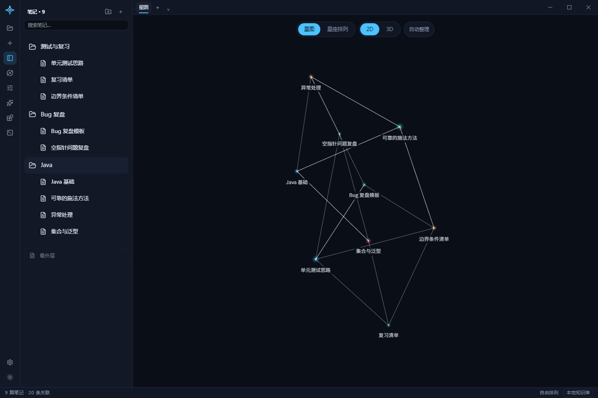
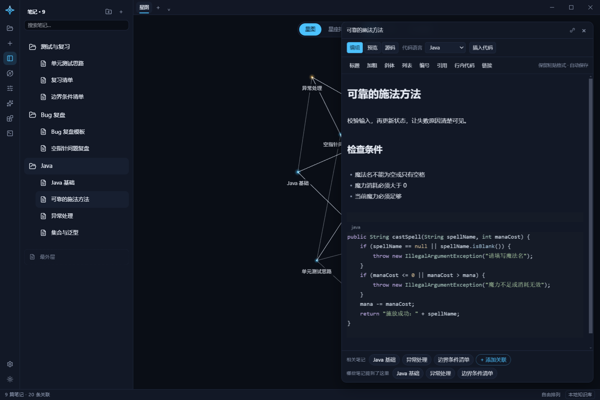

# Astro CN · 中文增强版

**把知识点、代码经验和错题，整理成自己的知识星图。**

[下载安装包](https://github.com/Cottins-Vanilla/Astro-CN/releases/latest) · [使用指南](docs/USER-GUIDE.zh-CN.md) · [开发构建](docs/DEVELOPMENT.zh-CN.md) · [更新日志](CHANGELOG.md) · [反馈问题](https://github.com/Cottins-Vanilla/Astro-CN/issues)

> 本项目基于 [Solen AI 的 Astro](https://github.com/Solen-AI-org/Astro) v0.1.1 制作，是独立维护的社区中文增强版，并非原作者的官方中文发行版。原作者版权及 MIT 许可证完整保留；本仓库主要提供中文体验优化、笔记编辑增强和问题修复。

## 适合用来做什么

- **程序员知识库**：记录 Java、前端、数据库等知识点，并用代码块保留示例。
- **错题与 Bug 复盘**：记录触发条件、错误原因、修复步骤和相关知识。
- **项目经验整理**：通过文件夹分类和笔记关联，把零散经验连接起来。
- **个人知识网络**：在 2D / 3D 星图中查看关联，点击星星直接打开笔记。

笔记保存在自己选择的本地文件夹中，正文采用 Markdown。普通记笔记无需登录账号，也无需配置 AI。

## 主要功能

| 功能 | 说明 |
| --- | --- |
| 中文界面 | 常用菜单、设置、提示、示例、内置插件和星座名称使用简体中文 |
| Markdown 编辑 | 编辑、预览、源码三种方式；支持标题、加粗、列表、引用、表格和任务项 |
| 格式化粘贴 | 识别常见富文本和 Markdown；支持从 VS Code 粘贴代码 |
| 代码笔记 | 多语言语法高亮、语言标签、代码复制；编辑时隐藏代码围栏 |
| 文件夹分类 | 新建、重命名、移动、删除；笔记与文件夹混合排序 |
| 嵌套移动 | 文件夹连同子目录、空目录和笔记一起移动，支持拖动和菜单操作 |
| 知识关联 | 双向链接和图谱关联；重命名时同步已有引用，保留笔记身份 |
| 2D / 3D 星图 | 点击查看、拖动整理、关联高亮、星座排列；2D 支持避让和自动整理 |
| 智能助手 | 可配置 DeepSeek 等服务及兼容接口；显示当前模型，可将回答插入当前笔记 |
| 本地保存 | 自动保存、知识库切换、导入导出；桌面版将笔记保存为本地文件 |

品牌、模型名称、代码、网址和第三方服务返回的内容可能保留原文。复杂图谱仍可能出现交叉连线；自动整理不能保证消除所有交叉。

## 效果预览

截图使用专门生成的演示笔记，不包含个人知识库、API 密钥或真实聊天内容。更多使用方式见[使用指南](docs/USER-GUIDE.zh-CN.md)。

## 下载和安装

1. 打开 [Releases](https://github.com/Cottins-Vanilla/Astro-CN/releases/latest)。
2. 下载 **Astro-CN-0.2.0-windows-x64-setup.exe**。
3. 运行安装向导，可选择安装目录和快捷方式。
4. 首次启动时，选择一个保存知识库的文件夹。

当前发行目标为 **Windows 10 / 11，x64**。普通使用不需要自行安装 Node.js 或 pnpm。此社区版本暂未购买代码签名证书，安装包不带发布者数字签名；发布页同时提供 SHA-256 校验文件。

已有本地中文版用户：安装版继续使用 Astro-Chinese 配置目录，可重新选择原来的知识库。升级前建议使用“导出知识库备份”。卸载程序不会主动删除保存在其他位置的知识库。

## 常用操作

| 操作 | 方法 |
| --- | --- |
| 打开笔记 | 点击星图中的星星，或点击左侧笔记 |
| 建立关联 | 按住 Shift，从一颗星拖到另一颗星 |
| 搜索操作和笔记 | Ctrl + K |
| 切换星座排列 | Ctrl + G |
| 编辑代码 | 在笔记工具栏选择语言并插入代码，或粘贴已有代码 |
| 查看 Markdown 原文 | 切换到“源码” |
| 整理分类 | 拖动左侧条目，或使用“…”菜单 |

文件夹在每次重新启动后默认收起；同一次使用中的展开状态会保留。

## 数据和隐私

桌面知识库采用以下结构：

~~~text
你的知识库/
└─ .astro/
   ├─ notes/       # Markdown 笔记，可包含分类目录
   ├─ canvases/    # 星图中手动建立的结构关联
   └─ vault.json   # 知识库设置
~~~

Windows 应用配置目录是 %APPDATA%/Astro-Chinese。不要把自己的知识库、应用配置或备份直接提交到公开仓库。

AI 是可选功能：启用后，发送的提问及所选上下文会交给你配置的模型服务。API 配置随知识库设置保存，目前不提供系统密钥链加密；共享知识库、截图或备份前应清除密钥。程序还保留上游的联网功能，例如打开网页和下载星座数据，因此“本地保存”不代表所有功能都离线。

## 从源码运行

需要 **Node.js 24 LTS、pnpm 11.25.0 和 Git**。

~~~sh
git clone https://github.com/Cottins-Vanilla/Astro-CN.git
cd Astro-CN
pnpm install --frozen-lockfile
pnpm build
pnpm --filter @solen/desktop start
~~~

只调试浏览器界面可运行 pnpm dev。浏览器版使用 IndexedDB，与桌面版的磁盘知识库分开。Windows 安装包构建、测试和目录说明见[开发指南](docs/DEVELOPMENT.zh-CN.md)。

## 项目结构

~~~text
apps/web/          React、CodeMirror 与 Three.js 界面
apps/desktop/      Electron 桌面外壳、本地文件和安装包配置
packages/core/     笔记格式、链接解析、图谱与存储接口
packages/plugin-api/ 插件接口
packages/mcp-server/ 上游 MCP 服务源码
scripts/           构建、许可和发布检查脚本
docs/              使用说明、开发文档及上游设计资料
~~~

MCP、终端、网页浏览及其他上游扩展仍处于持续验证范围。当前安装包不内置独立 MCP 服务运行包；需要该功能时请按上游文档从源码构建，不应将其理解为 AI 已具备任意创建、删除笔记的自动操作权限。

## 反馈和贡献

欢迎通过 [Issues](https://github.com/Cottins-Vanilla/Astro-CN/issues) 提交问题、功能建议和中文表达改进。请附上系统版本、应用版本、复现步骤和预期结果；截图请隐藏笔记隐私和 API 密钥。

提交代码前请阅读 [CONTRIBUTING.md](CONTRIBUTING.md)。安全问题按 [SECURITY.md](SECURITY.md) 说明处理，不要公开粘贴密钥。

## 开源许可与致谢

- 原项目：[Solen-AI-org/Astro](https://github.com/Solen-AI-org/Astro)，Copyright (c) 2026 Solen AI，采用 [MIT](LICENSE) 许可证。
- 本项目：在原项目基础上维护的中文增强版。当前 Git 历史从本地修改版源码快照开始，不包含上游完整提交历史；[来源与修改说明](docs/UPSTREAM.md) 记录了继承关系。
- 星座数据等材料另有许可，详见 [THIRD-PARTY-NOTICES.md](THIRD-PARTY-NOTICES.md)。安装包附带相关许可及依赖许可汇总。
- 感谢 Electron、React、CodeMirror、Three.js、D3 等开源项目。

本项目免费开源，不代表获得原作者或第三方项目的官方认证、合作或背书。
