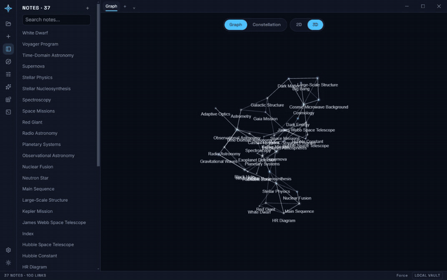
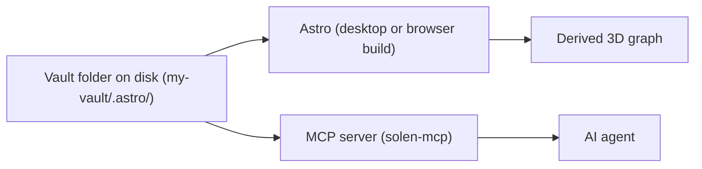
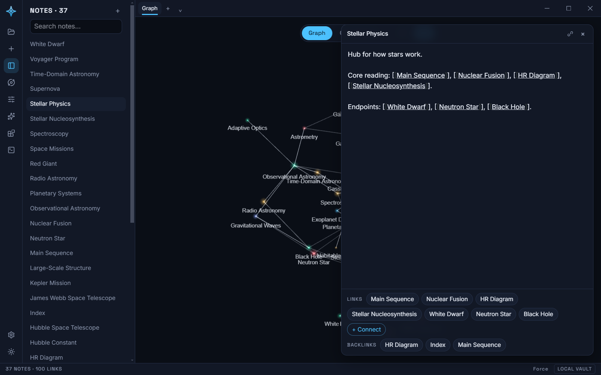
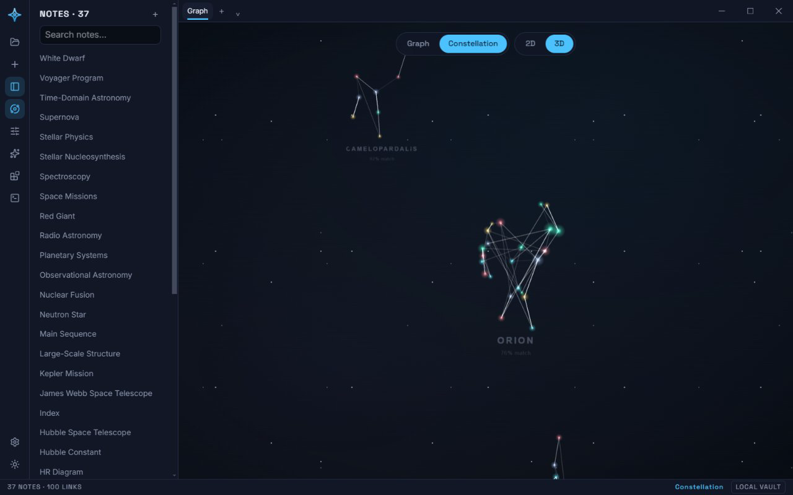
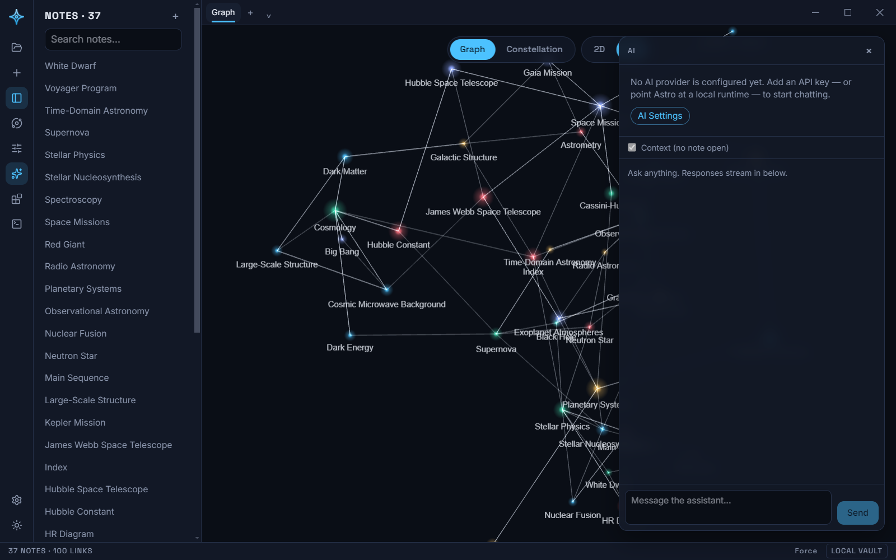
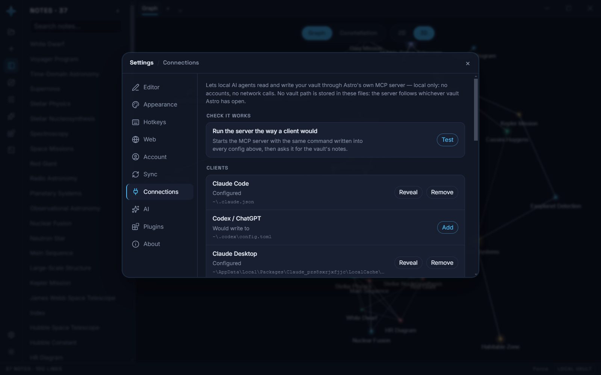

<div align="center">

# Astro

**A knowledge-graph workspace where every note is a star in a real, directly-editable 3D graph.**

[](https://github.com/Solen-AI-org/Astro/actions/workflows/ci.yml)
[](LICENSE)

[**Download for Windows**](https://github.com/Solen-AI-org/Astro/releases/latest) · [Build from source](#quick-start)



*Recorded from the desktop build. No mockups: the vault, the graph, the constellations and the note are all real.*

</div>

Astro is for anyone who thinks in networks of ideas — research, project
notes, a personal wiki — and wants them stored as plain files on their own
machine instead of inside a service. There's no document list with a canvas
bolted on the side: the 3D graph *is* the workspace. Click a star to open the
note, drag it to move it, hold Shift and drag between two stars to link them.

## Local-first, concretely

A vault is a folder on disk. Everything Astro writes lives under a hidden
`.astro/` subfolder inside it:

```
my-vault/
└── .astro/
    ├── vault.json          vault metadata + settings
    ├── notes/              one plain Markdown file per note (YAML frontmatter + CommonMark)
    └── canvases/           one JSON document per canvas (structural edges, the graph's edge store)
```

No database, no proprietary format. Any editor, static site generator, or
script can read a vault without running Astro. `[[Wiki-links]]` in note
bodies resolve by title; the knowledge graph itself is never stored — it's
derived fresh from the files every time. Full spec:
[docs/DATA-FORMAT.md](docs/DATA-FORMAT.md).



## Quick start

**Windows:** grab the installer from the
[latest release](https://github.com/Solen-AI-org/Astro/releases/latest) and run
it — no toolchain, no build step. It is unsigned, so SmartScreen will warn on
first run; "More info" → "Run anyway". macOS and Linux builds are not published
yet: build them from source with `pnpm --filter @solen/desktop dist`, which
produces a `.dmg` or an AppImage for the platform you run it on.

Astro ships two builds from the same code: a browser build (`apps/web`,
IndexedDB storage, nothing to install) and a desktop build (`apps/desktop`,
Electron, a vault is literally that folder on disk). **The desktop app is the
real product** — filesystem vaults, the multi-vault switcher, an integrated
terminal, and the MCP server all need it. The browser build is for trying
Astro with zero install.

**Browser build:**

```bash
git clone https://github.com/Solen-AI-org/Astro.git
cd Astro
pnpm install
pnpm dev        # → http://localhost:5173
```

**Desktop app:**

```bash
pnpm install
pnpm --filter @solen/web build      # apps/desktop loads apps/web's built dist/
pnpm --filter @solen/desktop dev    # compiles main/preload, launches Electron
```

`pnpm --filter @solen/desktop dist` packages an installer for your platform
(`.dmg` on macOS, NSIS on Windows, AppImage on Linux). See
[docs/DESKTOP.md](docs/DESKTOP.md) for the vault switcher, the integrated
terminal, and `SOLEN_VAULT_DIR` for scripted testing.

## The graph is the workspace

There's no separate canvas and no read-only map — you think *in* the graph.
Every note is a star in real XYZ space that you orbit, drag, and edit
directly; the editor, AI chat, and plugin panels float over that same sky as
their own cards instead of docking beside it, so opening a note never
resizes the graph underneath it. Structural links are a gesture, not syntax:
Shift-drag from one star to another and the connection is saved directly
into the vault — no brackets required, though `[[wiki-links]]` still work if
you type them. Details: [docs/WORKSPACE-3D.md](docs/WORKSPACE-3D.md).



### Constellation Mode

One toggle re-lays-out the exact same graph — same nodes, same links — as a
star chart. Clusters snap onto real IAU constellation shapes (Orion,
Cassiopeia, Ursa Major, and 83 more) whenever their connection pattern
statistically matches one, falling back to a generic asterism otherwise. It's
a different presentation of identical data, not a second graph. Details:
[docs/CONSTELLATION.md](docs/CONSTELLATION.md).



## AI on your own terms

AI is entirely opt-in. Bring your own key (Anthropic or any OpenAI-compatible
endpoint), point it at a local runtime (Ollama, llama.cpp server — no key at
all), or skip AI entirely. Keys live only in your local vault settings and go
only to the provider you picked.



### MCP + agent skills

The MCP server (`packages/mcp-server`, binary `solen-mcp`) exposes an open
vault's notes, search, and knowledge graph to any MCP-capable agent — Claude
Code, Claude Desktop, Codex/ChatGPT, Cursor, Antigravity, Goose — wired up
from **Settings → Connections** with one click per client. No vault path is
ever written into a client's config; the server always resolves whichever
vault Astro currently has open, so switching vaults in the app is what
changes what a connected agent can see. Full protocol and per-client details:
[docs/MCP.md](docs/MCP.md).



On top of that, [`skills/`](skills) ships two agent skills that turn a vault
into an AI's actual long-term memory, not just a data source:

- **[`astro-brain`](skills/astro-brain/SKILL.md)** writes the outcome of a
  working session back into the open vault as notes, then repairs broken
  wiki-links, orphans, and duplicates it finds along the way.
- **[`stardust`](skills/stardust/SKILL.md)** turns any folder — a codebase, a
  docs tree, a pile of papers — into a graph of notes and wiki-links inside
  the vault, so Astro's 3D sky becomes the visualization and an agent can
  walk the graph instead of grepping the folder.

Both are plain Markdown with a YAML header — no install step, no runtime.
They reach the vault the same way Astro's Connections pane does (MCP first,
a filesystem fallback if MCP isn't wired up), and neither ever hardcodes a
path. See [skills/README.md](skills/README.md).

## Plugins

A plugin is a JS/TS module that receives a typed `SolenAPI` object at load
time — the same surface Astro's own built-in features use — and registers
commands, panels, node types, themes, or event listeners against it. Zero
runtime dependencies, no framework requirement. See
[docs/PLUGINS.md](docs/PLUGINS.md) and the reference plugin at
[`apps/web/src/plugins/builtin/wordcount.ts`](apps/web/src/plugins/builtin/wordcount.ts).

## What's in the box

| Package | What it is |
|---|---|
| [`apps/web`](apps/web) | The app itself — 3D graph workspace, editor, command palette, AI panel, plugin host |
| [`apps/desktop`](apps/desktop) | Electron shell: filesystem vaults, the multi-vault switcher, integrated terminal, in-app browser |
| [`packages/core`](packages/core) | Data model, vault adapters, wiki-link parsing, graph derivation |
| [`packages/plugin-api`](packages/plugin-api) | The typed surface plugins build against |
| [`packages/mcp-server`](packages/mcp-server) | `solen-mcp` — expose a vault to AI agents over MCP |
| [`skills`](skills) | `astro-brain` and `stardust` — agent skills that make a vault an AI's memory |

## Documentation

- [Architecture](docs/ARCHITECTURE.md)
- [Vault data format](docs/DATA-FORMAT.md)
- [Design language](docs/DESIGN.md)
- [The 3D workspace](docs/WORKSPACE-3D.md)
- [Constellation Mode](docs/CONSTELLATION.md)
- [Plugin development](docs/PLUGINS.md)
- [MCP server](docs/MCP.md)
- [Agent skills](skills/README.md)
- [Desktop app](docs/DESKTOP.md)
- [Roadmap](docs/ROADMAP.md)

## Maturity

The core app — graph, editor, plugins, both builds — works end to end and is
young. Specifically, not yet real:

- **Sync** — Settings → Sync is marked "coming soon." Today a vault is local
  to one machine (or synced by whatever external tool you point at the
  folder yourself); a first-party sync service is a v0.4 roadmap item.
- **Google sign-in** — proves who you are and nothing else yet. It doesn't
  back up, sync, or attach your vault to anything.
- **Mobile** — doesn't exist.

Good first contributions right now are plugins, themes, and issues that
sharpen the roadmap. Open an issue before a large change.

Found a security issue? Please report it privately — see [SECURITY.md](SECURITY.md),
not a public issue.

## License

[MIT](LICENSE).

Astro bundles constellation line-figure data derived from
[d3-celestial](https://github.com/ofrohn/d3-celestial) (BSD-3-Clause) — full notice in
[THIRD-PARTY-NOTICES.md](THIRD-PARTY-NOTICES.md).
