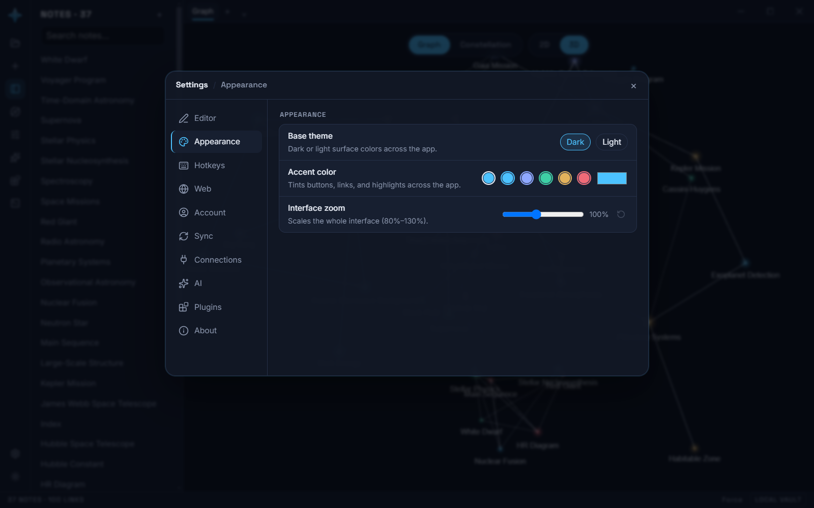

# ARCH: Appearance settings + fluidity pass (Obsidian-inspired)

Build spec. Source inspiration: Obsidian's Settings → Appearance page (base theme /
accent color / font sizing / zoom — see the official settings docs at
https://obsidian.md/it/help/settings) and its left-nav settings layout. Scope is
deliberately the subset that fits Astro's existing token system — no CSS snippet
engine, no font pickers, no community-theme machinery.

## 1. Settings modal: left-nav layout

`SettingsModal.tsx` currently renders horizontal tab buttons ("AI Provider" /
"Plugins"). Restyle to Obsidian's shape: a left nav column listing sections, the
active section's content on the right.

- Sections: **Appearance** (new, first), **AI Provider**, **Plugins**. (The "AI
  Provider" tab was later relabeled **AI**, and more sections — Editor, Hotkeys,
  Web, Account, Sync, Connections, About — were added after this spec; see
  `SettingsTab` in store.ts for the current list.)
- `SettingsTab` type in store.ts gains `"appearance"`; default tab becomes
  `"appearance"` when opened with no argument (existing callers that pass
  `"ai"`/`"plugins"` keep working).
- CSS: `.settings-nav` (left column, ~160px, list of `.settings-nav-item`
  buttons, active gets `--color-surface-2` pill), `.settings-body` (right,
  scrollable). Reuse the modal's existing shell/backdrop untouched.

## 2. Appearance section content

As shipped — base theme, accent swatches, and the zoom slider with its
reset-to-100% control on the right:

Three controls, all persisted under `settings.ui` (the existing `UiSettings`
bucket in store.ts — extend it):

1. **Base theme** — the existing `theme` setting ("dark"/"light"), surfaced here
   as two labeled cards or a simple segmented control. Reuses `setTheme`; the
   Command Palette actions stay.
2. **Accent color** — NEW `settings.ui.accentColor?: string` (hex). A row of ~6
   preset swatches (the existing star-accent palette hexes: #4cc2ff, #8fa8ff,
   #3ecfa5, #e3b25c, #ef6b78, plus default) + a native `<input type="color">`
   for custom. Applying: set `--color-accent` inline on `document.documentElement`
   (`style.setProperty`) in the same App.tsx effect family that stamps
   `data-theme`; clearing (default swatch) removes the override so the theme's
   own value returns. Both themes' `--color-accent-contrast` stays as-is —
   acceptable for v1 (dark contrast text on a user-picked light accent is the
   user's choice). (Electron's native `titleBarOverlay` — which once needed the
   same ordering concern — was later removed in favor of Astro's own themed
   window-control buttons; see `apps/web/src/components/WindowControls.tsx`.)
3. **Interface zoom** — NEW `settings.ui.uiZoom?: number` (0.8–1.3, step 0.05,
   default 1). Under Electron apply via CSS `zoom` on `#root` (supported in
   Chromium, zooms layout cleanly including canvases' CSS size; the 3D canvas
   resize observer already tracks its container so WebGL re-fits itself).
   Show value as a % next to a slider. `// ponytail: CSS zoom, not
   webFrame.setZoomFactor — no IPC, no preload change, same visual result.`
   (A reset-to-100% button was added beside the slider afterwards; the slider
   value itself persists through `settings.ui` like every other row here, so
   closing the app, restarting it, or rebooting keeps whatever zoom was set.)

All three rows follow one visual pattern: label + description (muted, --text-xs)
left, control right — Obsidian's settings-row look. CSS: `.settings-row`,
`.settings-row-info`, `.settings-row-title`, `.settings-row-desc`,
`.accent-swatch` (+ `.active` ring).

## 3. Fluidity micro-pass (design tokens only, no library)

- Tab strip: `.workspace-tab` gets `transition: background 150ms ease, color
  150ms ease`; active tab's accent underline animates in via `transform:
  scaleX` on an `::after` pseudo-element (150ms var(--ease-out)).
- `.settings-nav-item`, `.accent-swatch`, `.palette-item`: same 150ms
  hover/active transitions and the app's existing pressed `transform:
  scale(.97)` feedback.
- Global `:focus-visible` ring: `outline: 2px solid
  color-mix(in srgb, var(--color-accent) 70%, transparent); outline-offset: 2px`
  on interactive elements (buttons, inputs, tabs) — currently absent; both an
  accessibility fix and an Obsidian-like touch.
- All inside the existing `prefers-reduced-motion` collapse (already global).

## 4. Out of scope (explicitly)

Font family pickers, CSS snippets, community themes, hotkey editor, per-note
reading/source modes — Obsidian features that don't map onto Astro's current
surface. Listed so nobody "helpfully" adds them.

## Files

- `apps/web/src/store.ts` — `SettingsTab` + `UiSettings` + `accentColor`/`uiZoom`
  state, setters persisting to `settings.ui` (same `persistUi` pattern the
  sidebar/dimension toggles already use).
- `apps/web/src/App.tsx` — accent + zoom application effects (combined with the
  existing theme effect; keep ordering correct).
- `apps/web/src/components/SettingsModal.tsx` — left-nav restyle + Appearance section.
- `apps/web/src/index.css` — settings-nav/row/swatch classes + fluidity pass (§3).
