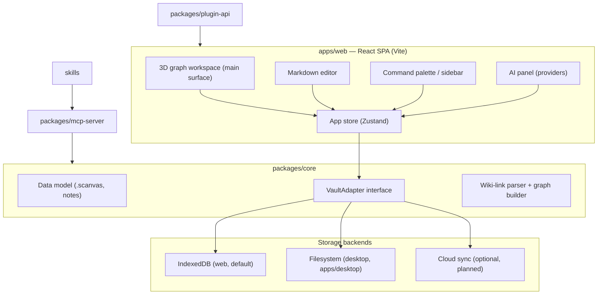

# Architecture

Astro is a **local-first knowledge workspace**: an infinite canvas where
notes, ideas, and projects live as connected nodes, backed by plain files the
user owns. This document describes how the system is put together and why.

## Design principles

1. **Local-first.** The vault (all user data) lives on the user's machine in an
   open, documented format. No account, no server, no lock-in. Cloud sync is an
   optional layer, never a requirement.
2. **Open format over open API.** Notes are Markdown, canvases are versioned
   JSON. Any tool can read a vault without running Astro.
3. **Small core, everything else is a plugin.** The core ships the canvas, the
   editor, the graph, and the vault. Node types, panels, commands, and AI
   providers are extension points.
4. **Use what exists.** Mature MIT-licensed libraries over bespoke code:
   rendering, editing, layout, and storage are all delegated to
   well-maintained dependencies.

## System overview



## Packages

| Package               | Responsibility                                                                 |
|-----------------------|--------------------------------------------------------------------------------|
| `packages/core`       | Data model and types, `.scanvas` (de)serialization, wiki-link parsing, knowledge-graph derivation, `VaultAdapter` interface, IndexedDB adapter. Framework-agnostic — no React. |
| `packages/plugin-api` | The public, semver-stable TypeScript API plugins and integrations build against: commands, panels, custom node types, AI providers, vault events. |
| `packages/mcp-server` | Standalone Node server implementing the Model Context Protocol. Follows whichever vault the desktop app currently has open (or an explicit `--vault` directory) and exposes tools (list/read/write notes, list/read canvases, query graph) to any MCP-capable AI agent. |
| `apps/web`            | The application: 3D graph workspace, editor, sidebar, command palette, settings, themes, AI panel, plugin host. |
| `apps/desktop`        | Electron shell around `apps/web`'s build: a `FilesystemVaultAdapter` backs the same `VaultAdapter` interface with a real folder on disk, plus a multi-vault switcher, the integrated terminal, and MCP client wiring. |
| `skills`              | Not code — Markdown agent skills (`astro-brain`, `stardust`) that reach a vault through the MCP server above. No build step, no runtime. See [../skills/README.md](../skills/README.md). |

### Internal packages resolve from source, not from `dist/`

`@solen/core` and `@solen/plugin-api` are `private` workspace packages, never
published to npm, and both point their `types` at `src/index.ts` while their
runtime entry stays `dist/index.js`. That asymmetry is deliberate: type
resolution must work on a clone that has not been built yet.

It used to not. `pnpm -r typecheck` on a fresh checkout failed with `Cannot
find module '@solen/core'`, because the declarations it names only exist after
`pnpm -r build` has run — which is exactly what CI hit on its first green-field
run. `apps/web/vite.config.ts` had already solved the same problem for `pnpm
dev` by aliasing both packages to their source; this is that decision applied
to the compiler as well, so typecheck, the editor, and CI all work in a
freshly cloned repo with no build step first.

The trade-off: consumers now typecheck those packages' source rather than
skipping their `.d.ts` under `skipLibCheck`, so a type error inside `core`
surfaces in every consumer instead of only in `core`. That is the more useful
direction to fail in.

## Key components

### 3D graph workspace

The app's main, directly-editable surface — see [WORKSPACE-3D.md](./WORKSPACE-3D.md).
Built on [three.js](https://threejs.org) for rendering (pooled buffers, one
draw call per primitive class) and [d3-force-3d](https://github.com/vasturiano/d3-force-3d)
for physics. Click opens a note, drag repositions a star, shift-drag draws a
structural link between two notes, double-click creates one — all zero-syntax
direct manipulation on the same graph Constellation Mode re-lays-out as a
star chart (see [CONSTELLATION.md](./CONSTELLATION.md)).

The 2D canvas UI (once built on React Flow) is gone, but the `.scanvas`
format it used stays part of the vault: canvases are now purely the graph's
structural-edge store — every link a graph gesture creates is an entry in a
canvas doc's `edges` array, the same shape canvases have always used. Nothing
in `packages/core` changed; only the UI that edited canvases directly was
removed.

### Vault

A vault is the unit of user data: a set of notes, canvases, and settings.
All access goes through the `VaultAdapter` interface in `packages/core`:

```ts
interface VaultAdapter {
  listNotes(): Promise<NoteMeta[]>
  readNote(id: string): Promise<Note>
  writeNote(note: Note): Promise<void>
  deleteNote(id: string): Promise<void>
  listCanvases(): Promise<CanvasMeta[]>
  readCanvas(id: string): Promise<CanvasDoc>
  writeCanvas(doc: CanvasDoc): Promise<void>
  deleteCanvas(id: string): Promise<void>
}
```

The web app ships an IndexedDB implementation (via Dexie). The desktop app
(`apps/desktop`) implements the same interface over the real filesystem —
`FilesystemVaultAdapter`, one Markdown/JSON file per note or canvas, written
through the main process and reached from the renderer over IPC
(`window.vaultAPI`) — with a switcher for working across multiple vault
folders; a future sync service would implement it over a replicated store.
Nothing above the interface changes.

Vault export/import round-trips through the on-disk format described in
[DATA-FORMAT.md](./DATA-FORMAT.md), so a vault created in the browser can be
extracted as a plain folder of Markdown and JSON at any time.

### Knowledge graph

The graph is **derived, not stored**: `[[wiki-links]]` in note bodies and
edges on canvases are parsed into a link index by `packages/core`. The 3D
graph workspace renders that index with a force-directed layout (`d3-force-3d`)
or, in Constellation Mode, a deterministic star-chart layout. Deleting the
index loses nothing — it is rebuilt from the source files.

### Markdown editor

CodeMirror 6 with Markdown syntax highlighting, `[[wiki-link]]`
autocompletion, and live preview. Notes are plain CommonMark plus
frontmatter — no proprietary syntax.

### Plugin system

Plugins are JavaScript modules that receive a `SolenAPI` object at load time
and register capabilities against it:

```ts
export default {
  id: "my-plugin",
  onload(api: SolenAPI) {
    api.commands.register({ id: "my-plugin.hello", name: "Say hello", run: ... })
    api.nodes.registerType({ type: "kanban", render: ... })
  },
  onunload() { ... }
}
```

The API surface lives in `packages/plugin-api` and is the same surface the
app's own built-in features use, which keeps it honest.

### AI layer

AI is opt-in and provider-agnostic. A single `AIProvider` interface covers:

- **Bring-your-own-key** — Anthropic and OpenAI-compatible HTTP APIs; keys are
  stored locally in the vault settings and never leave the machine except to
  the provider the user chose.
- **Local models** — any OpenAI-compatible local runtime (e.g. Ollama,
  llama.cpp server) via base-URL configuration.
- **Hosted subscription** — a slot for an optional first-party hosted tier,
  implemented as just another provider.

Agents integrate from the outside through the MCP server, which gives them
read (and optionally write) access to the vault with the user's consent.

### Theming

Themes are CSS custom-property sets. The app ships dark and light; plugins
can register additional themes. The active theme is a vault setting.

## Data flow

1. UI events mutate the Zustand store (optimistic, synchronous).
2. A persistence middleware debounces store changes and writes them through
   the active `VaultAdapter`.
3. Vault writes emit events; the link index and graph view update
   incrementally.
4. Plugins observe the same event bus and command registry as core features.

## Non-goals (for now)

- Real-time multi-user collaboration.
- A required backend of any kind.
- WYSIWYG rich-text editing — Markdown stays the source of truth.
