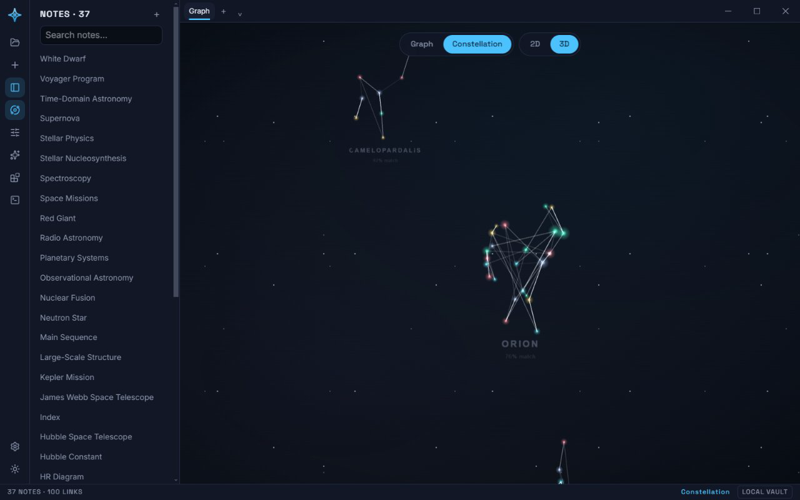

# Constellation Mode — architecture

The graph view is a real 3D force-directed graph. **Constellation Mode is not
another graph** — it is another *presentation* of the exact same graph:
identical topology, identical IDs, identical interactions. Switching modes
moves stars; it never creates or destroys them.



Target: 60 FPS on integrated graphics with thousands of nodes, in the
browser today and in the desktop build tomorrow. The effect comes from
CPU-friendly **layout changes**, not expensive GPU work.

## Layer separation

```
┌─────────────────────────────────────────────────────────┐
│ GraphView3D (React shell: input, mode switch, overlay)  │
├─────────────────────────────────────────────────────────┤
│ LayoutTransition        │ AdaptiveQuality               │
│ (animate between        │ (frame-time driven            │
│  layouts, cancellable)  │  quality tiers)               │
├─────────────────────────┴───────────────────────────────┤
│ GraphLayout (interface) │ GraphPhysics                  │
│  • ForceLayout ────────── reads ── (d3-force-3d sim)    │
│  • ConstellationLayout    (pure CPU, deterministic)     │
├─────────────────────────────────────────────────────────┤
│ SceneRenderer (three.js: pooled buffers, one draw call  │
│ per primitive class; no post-processing)                │
└─────────────────────────────────────────────────────────┘
```

Physics, layout, transition, and rendering never reach into each other's
state: they all read/write one shared, preallocated `positions:
Float32Array` (xyz per node). The renderer doesn't know which layout is
active; a layout doesn't know how it will be drawn. Constellation Mode is
therefore an *extension* — one more `GraphLayout` — not a special case.

There is one number both sides genuinely have to agree on: how far the camera
can ever reach. `constellation.ts` sizes `DOME_RADIUS_BUDGET` from it (see
"Celestial dome" below) and the renderer sets its controls and fog from it,
and the two silently drifting apart is exactly what let the dome outgrow the
reachable volume once already. It therefore lives in **`viewBudget.ts`** — a
dependency-free module owned by neither — rather than the layout importing
the renderer, which would drag three.js into a pure-CPU module graph and
break the separation above for the sake of two constants.

## The layout interface

```ts
interface GraphLayout {
  id: string;
  /** Fill `out` with xyz per node. Must be deterministic for a given
      topology (seeded by node id hash) and must never add/remove nodes. */
  generate(topology: GraphTopology, current: Float32Array, out: Float32Array): void;
}
```

- `ForceLayout` — copies the live d3-force-3d simulation positions.
- `ConstellationLayout` — see below; maps every cluster onto a real named
  figure (Orion, Cassiopeia, Cygnus, Scorpius, …), per "Named patterns" below.
- Future: custom plugin-registered patterns and layouts implementing the
  same interface, plugging into the same transition machinery.

## ConstellationLayout algorithm (pure CPU)

**Constellation Mode is explicitly allowed to disregard graph topology** in
order to build good constellations — a licence Force mode does not have.
Force mode's layout always reads the real graph exactly as its edges say it
is; Constellation Mode's partition step below uses adjacency only as a
*preference*, never a constraint, and the rest of this section is the
deliberate consequence of that.

1. **Partition** every node into constellation-sized groups
   (`partitionGraph`), regardless of whether the underlying graph is one
   giant connected component or a hundred tiny ones — a real vault is very
   often the former, which is exactly why "cluster = connected component"
   (the old approach) always drew exactly one constellation no matter how
   large the vault got. Seeds are picked highest-degree-first (ties by id
   hash, ascending); each seed's region then grows by repeatedly claiming
   whichever unassigned, already-adjacent node has the next-highest degree,
   stopping the instant it reaches a target size (12 stars — comfortably
   inside real IAU constellations' 3–27-star range) no matter how strongly
   the next node outside the region is linked to it. Anything that couldn't
   grow past its own seed (an isolated note, or a small component fully
   consumed) becomes its own tiny region, which `mergeSmallClusters` then
   folds into another region with room to spare (preferring one it has a
   real edge into) — so nothing below 5 stars, and no random scatter,
   survives to the next step. The number of constellations grows with the
   vault: a few hundred notes produce dozens of constellations, not one.
2. **Asterism per cluster**: map the cluster onto a real named pattern — see
   "Named patterns" below for why this is now the default outcome, not a
   sometimes-thing. The plain breadth-first fallback (highest-degree node as
   the "alpha star", children placed at quasi-regular angles along gently
   bent polylines — the classic star-chart look, still used for its own
   sub-fragments by `placeStrayFragments` below) only runs for a cluster too
   small for even the smallest real pattern (3 stars), which in practice
   means a whole vault of 1-2 notes. Jitter is seeded from node id hashes
   either way, so the same vault always draws the same sky. A cluster
   `mergeSmallClusters` stitched
   together from two (or more) previously-disconnected pieces gives every
   piece unreachable from the alpha star its own full recursive asterism —
   `placeStrayFragments` groups the leftovers back into their own connected
   components and packs each one's local origin against whatever's already
   placed using the same non-overlapping golden-spiral packer described in
   step 3 below, one level down. This replaced first a uniform random
   scatter, then (still wrong) a small fixed-radius companion orbit around
   alpha sized for a straggler or two — measured to squeeze an entire
   merged-in fragment (not just a stray note) into a disc smaller than one
   star's own label footprint once a real vault produced one. A pattern's
   own genuine overflow companions (more cluster members than the matched
   pattern has slots — a different, small-scale case) still orbit their own
   spanning-tree parent at a modest radius, unchanged.
3. **Celestial dome, without overlap, and always in view**: each cluster's
   real local footprint (`localBoundingRadius` — how far its farthest star,
   or its name label, sits from its own local center) sizes its berth on a
   golden-angle spiral (`placeClusters`): cluster *i* goes out along its own
   ray at the smallest radius that still clears every already-placed
   cluster's disc, an exact greedy circle-packing (not a fixed formula with
   no idea how big any cluster actually is), which guarantees no two
   constellations' bounding discs — or their name labels — ever intersect,
   for every pair, regardless of cluster count or size. Packing alone still
   doesn't *bound* how big the sky gets, though (it grows roughly with
   √cluster-count rather than unboundedly linearly, but still grows) — a
   final **fit-to-budget pass** uniformly scales every position down, if
   needed, so the outermost star never sits past `DOME_RADIUS_BUDGET`, a
   radius derived from the renderer's own real camera pull-back limit
   (`CAMERA_MAX_DISTANCE`) and fog cutoff (`FOG_FAR`) rather than a
   duplicated magic number. A uniform scale can't undo the packing's
   non-overlap guarantee (two already-separated discs stay separated at any
   common scale), so this is provably safe on top of it. Depth (z) is
   compressed (~0.3×) based on placement *order* and scaled by the same
   factor, so the dome stays self-similar rather than going flatter or
   deeper than its own footprint.

   **The honest cost**: for a large vault, the fit-to-budget scale shrinks
   *every* constellation's own internal star spacing by the same factor, not
   just the space between constellations — because "the whole sky must fit
   in view" and "each constellation stays individually legible" trade off
   directly once there are enough constellations, and the former is the one
   this mode can't compromise on (unreachable content is a worse failure
   than a dense sky). Measured on a synthetic branching-tree vault: at 40
   notes the scale is ~0.85 (barely shrunk); at 1,000 notes ~0.20; at 10,000
   notes ~0.07. In practice this reads as a genuinely dense star field once
   a vault reaches the high hundreds/low thousands of notes — correct
   star-chart behavior for that much content, but real, and worth knowing
   rather than discovering by eye.
4. **Magnitude**: node degree → star size/brightness, same mapping as the
   force layout, boosted by a uniform Constellation Mode brightness
   multiplier on top (see "Brightness" below) so nothing pops relative to
   Force mode's own star sizing, just brighter as a mode.

Cost: partitioning and placement are linear-ish in node/edge count (see
`partitionGraph`/`mergeSmallClusters`'s own doc comments for why merging
looks up each node's current cluster directly instead of rebuilding a
membership set per candidate); the whole `generate()` call runs once per
topology rebuild, never per frame. Measured on synthetic vaults shaped like
a branching note-tree: ~8ms at 300 nodes, ~70ms at 5,000, ~170ms at 10,000.

## Named patterns

The BFS asterism above is symmetric and blob-shaped — real constellations
are sparse, lopsided chains and polygons. `apps/web/src/graph3d/layouts/patterns.ts`
is **generated, not hand-written**, from the real IAU constellation
line-figure geometry ([d3-celestial](https://github.com/ofrohn/d3-celestial),
BSD-3-Clause): 86 real constellations (Ursa Major, Ursa Minor, Orion,
Cassiopeia, Leo, and every other officially recognized figure that clears a
3-star minimum), sizes 3–27 stars. See
[ARCH-CONSTELLATIONS.md](./ARCH-CONSTELLATIONS.md) for the full data
pipeline and how a fresh copy gets downloaded at runtime. Each pattern is
just data: normalized star positions (index 0 is the highest-degree
"anchor" star) plus a `parent` array describing the constellation's own
spanning tree, used for ordering and for placing overflow nodes.

**Every cluster is mapped onto a real pattern.** This is a reversal from an
earlier version of this feature, which reserved a name for a cluster whose
shape convincingly resembled a real constellation and left most clusters
unnamed. That premise is superseded: because Constellation Mode already has
an explicit licence to disregard topology (see the algorithm's own opening
paragraph above) for *positions*, choosing to draw a real IAU figure and
place a cluster's notes into its slots — regardless of how well the
cluster's own connectivity happens to resemble that figure — is the same
licence applied to *shape*. There is no confidence floor any more: `null`
(→ the plain BFS fallback) is returned only when literally no pattern is
small enough to fit inside the cluster at all, which — given the smallest
real pattern is 3 stars and `mergeSmallClusters` never leaves a cluster
below that except when the *whole vault* has 1-2 notes — essentially never
happens against a real vault. The displayed match percentage changes
meaning accordingly: it no longer answers "is this worth naming?" (every
sufficiently large cluster gets named regardless), it answers "how closely
did this cluster's own structure happen to agree with the figure it was
drawn as?" A low percentage is honest information — a merged, otherwise
unrelated coalition of notes drawn as Ursa Major and openly showing "38%
match" — not a failure this system tries to hide behind a fallback.

**Size is a hard GATE; shape is the SCORE; size-closeness is a soft
RANKING preference on top.** `selectPattern(topology, members)` first
filters to patterns whose size is compatible with the cluster (never bigger
than it, and not needing more overflow than `MAX_OVERFLOW_FRACTION` allows,
i.e. more than half the pattern's own star count as unslotted "companions")
— pure eligibility, not a scoring input. Among the survivors, it compares
**degree sequences** — each side's sorted list of cluster-internal /
pattern-internal connection counts — for shape alone (this is `PatternMatch
.score`, the number shown to the user); a pattern bigger than the cluster
has no slot for the missing star, so a good SHAPE match at a badly-fitting
SIZE would still strand many members as companions, which is what makes a
mapped figure stop reading as itself. Among near-tied shape scores,
`selectPattern` therefore also weights RANKING (not the displayed score)
toward the pattern needing fewer companions relative to the cluster's own
size — see `SIZE_PREFERENCE_WEIGHT`'s doc comment for the measured case this
fixes (a 24-member cluster that used to pick a 20-star pattern over a
23-star one for a sub-1-point shape edge, at 4x the companion count) and why
the weight is small enough to never overrule a genuinely better-shaped
smaller pattern's own already-companion-free pick.

This scoring split — shape as the pure, honest, displayed number; size
compatibility as gates/ranking, never blended into the score itself — used
to be blurred: an older version blended `0.5 * shapeSimilarity + 0.5 *
sizeSimilarity` into one number, which meant a cluster merely close in size
to some pattern collected roughly half its score before its actual shape
was considered at all. Keeping the two fully separate is what makes the
displayed percentage mean only one thing.

**Edge-aware slot assignment.** Once a pattern is chosen: build the cluster's
own BFS spanning tree from its alpha star (children sorted by degree desc,
then id hash asc), and walk it in DFS preorder to get a node order. Walk the
pattern's `parent` tree in DFS preorder (children in index order) to get a
slot order. Zip the two orders one-to-one — cluster node *i* takes slot *i* —
so graph edges that follow the spanning tree tend to run along the drawn
shape, and the cluster reads as the named constellation. Pattern coordinates
are scaled by `RING_SPACING * (1.1 + 0.22 * sqrt(slotCount))` so adjacent
stars land at roughly the same spacing as the BFS asterism. Nodes beyond the
pattern's slot count ("overflow") become companion stars: each orbits its
own spanning-tree parent's final position at a small id-hash-seeded angle
and radius (0.12–0.2 pattern units). Every random draw is seeded from
node/cluster id hashes, so selection and placement are both fully
deterministic — same vault, same sky.

**Shape completion.** A cluster's real edges rarely trace the same pairs as
the matched constellation's official line figure, so any pattern connection
with no matching real edge is drawn as a dim, non-interactive **synthetic
edge** (`ConstellationLayout.syntheticEdges`) — see
[ARCH-CONSTELLATIONS.md](./ARCH-CONSTELLATIONS.md) for detail.

**Labels.** In Constellation Mode only, each pattern-mapped cluster gets a
faint small-caps name label (the pattern's Latin/IAU `name`) plus a smaller,
dimmer match-percentage line underneath it, rendered as a pooled,
theme-tinted `THREE.Sprite`, positioned under the cluster's local bounding
box. Labels fade in over the same duration as the layout transition and are
never raycast-targeted. Fallback (BFS) clusters get no label, and switching
to Force mode removes every label outright rather than fading them out.

**Per-star titles are hidden.** The only text on screen in Constellation
Mode is a constellation's own name/match-percent labels above — the CPU-
projected per-note titles `SceneRenderer.updateLabels` draws in Force mode
are suppressed entirely (`this.constellationClusterOf !== null` gates the
whole function to a no-op, and the label canvas is cleared every frame
regardless, so a mode switch never leaves a stale title behind). Dozens of
note titles scattered across a mapped figure is exactly what stopped the
figures reading as figures. The one exception: hovering a star still shows
that star's own title (and nothing else — not its neighbors, who may belong
to a different constellation entirely) — with every other label gone, hover
is the only way left to learn which note a given star actually is, and a
single label can't re-clutter the sky the way dozens did. Force mode's
titles (top-N by degree, plus hover and its neighbors) are unaffected.

## Brightness

Constellation Mode's stars and links read differently from Force mode's, on
top of the existing degree-based size/opacity mapping — a rendering-only
change layered on in `renderer.ts`, using the same per-vertex attributes
Filters-section dimming and hover already write to (`aHighlight` for stars,
the edges' RGBA `color` attribute), rather than a new shader or material:

- **Stars shine brighter.** `SceneRenderer.setConstellationEmphasis` applies
  a uniform brightness multiplier to every star while active, composing
  multiplicatively with hover/select and the Filters section's dimming
  (`applyPointHighlight`) — neither stops working.
- **Same-constellation links brighten; cross-constellation links are hidden
  outright.** Every real edge already gets a brightness multiplier from
  hover state and the "Link thickness" slider (`applyEdgeHighlight`);
  Constellation Mode brightens an edge whose two endpoints share a
  constellation (`ConstellationLayout.clusterOf`) so its own asterism lines
  read as its shape — and fully hides one that crosses into a different
  constellation, rather than merely dimming it. This used to be a dim
  multiplier (0.55); measured against a real vault it wasn't enough,
  because `linesMaterial` is additively blended and `partitionGraph` is
  explicitly permitted to ignore topology, so a vault's real links rarely
  respect the partition and cross-constellation edges vastly outnumber
  same-constellation ones — enough faint overlapping lines sum back toward
  full brightness under additive blending regardless of the per-edge
  opacity chosen, which is exactly the "whole view reads as one connected
  web" complaint this mode exists to fix. Hiding them is the one option that
  doesn't degrade as a vault (and its cross-edge count) grows; the cost is a
  real cross-constellation link becoming invisible while this mode is
  active, which the "may disregard the graph entirely" licence explicitly
  covers. `pickEdge` skips a hidden cross-constellation edge the same way it
  already skips a Filters-hidden one, so it can't be clicked/unlinked either.

`GraphView3D` calls `setConstellationEmphasis` with `ConstellationLayout`'s
`clusterOf` every time it (re)generates the constellation layout, and with
`null` on every path back to Force mode — restoring Force mode's exact
historical look, not a "neutralized" version of this feature.

## Transitions

On mode switch: snapshot current positions → `layout.generate(target)` →
interpolate current→target with cubic ease over ~900 ms in the existing rAF
loop. The camera is left untouched. A switch mid-flight cancels the running
animation and retargets *from the interpolated state* — no jumps. Physics is
paused while a static layout is active and resumed (with low alpha) on
return to the force layout.

## No note titles on the sky

Force mode captions the top stars by degree (plus whatever is hovered and its
neighbours) with their note titles. Constellation Mode draws **none of them**:
the only text is each constellation's own name and match percentage, as the
sprite labels described under "Named patterns". Dozens of note titles strewn
over a figure is exactly what stopped the figures reading as figures — a star
chart labels constellations, not every individual star.

The one exception is the hovered star, which still shows its own title and
nothing else. With every other label gone that is the only way left to find
out which note a given star is, and a single label cannot re-clutter the sky.
Its neighbours are deliberately *not* labelled alongside it the way they are
in Force mode — that is what turns one hover into a paragraph of overlapping
text. `SceneRenderer.updateLabels` gates all of this on
`constellationClusterOf !== null`, the same flag the brightness pass uses, so
there is no second notion of "are we in Constellation Mode" to keep in sync.

## Dragging a star drags its constellation

In Force mode, dragging a star moves only that star (and pins it into the
physics sim while held). In Constellation Mode, `GraphView3D`'s pointer
handlers resolve the grabbed star's whole cluster via
`ConstellationLayout.clusterOf` at the start of the drag and translate every
member of it by the same per-frame delta, so the figure stays rigid — a
single-star drag would otherwise tear apart the very shape this mode exists
to draw. No physics `pin`/`unpin`/`reheat` calls happen on this path: a
static layout, not the (paused, non-ticking) simulation, owns these
positions in this mode, so pinning would register a constraint with a
solver that isn't running, and reheating would just fight the layout.
Releasing the drag leaves the constellation exactly where it was dropped —
there's no "settle" step to run, since nothing is animating it.

This can push a manually-dragged constellation into a neighboring one's
berth, breaking `placeClusters`'s no-overlap guarantee. That's accepted
deliberately: the guarantee exists to keep the *generated* sky from
overlapping itself, not to overrule a placement a person chose by hand. The
next topology rebuild (or mode round-trip) regenerates the sky from scratch
and the guarantee is back in force.

## Camera: sway (3D) and the flat chart (2D)

A full orbit would eventually show the dome from behind, mirroring every
label — unreadable. So in 3D, Constellation Mode's idle camera motion is a
gentle azimuth **sway** instead of a rotation: ±25° around the face-on
direction, slow sinusoid, polar angle held steady so the asterism and its
labels stay legible throughout. It shares Force mode's idle/interaction gate
(see docs/WORKSPACE-3D.md's "2D / 3D") — touching the camera or dragging a
star pauses it, and it resumes a couple of seconds after you stop.

Switching to 2D (the same toggle) locks the camera face-on with rotation
disabled, which turns the dome into a plain, fully-readable flat star chart —
no sway, no depth, just the asterism and its labels. This needs no layout
change here: `ConstellationLayout` already produces a full 3D dome; 2D is
purely a camera concern, handled by `renderer.ts`.

## Rendering budget

Allowed: one `THREE.Points` draw for all stars (size/color/phase as buffer
attributes, radial-gradient sprite texture, additive blending), one
`THREE.LineSegments` draw for all edges (vertex-color gradients, opacity by
mode), a 2D overlay canvas for the top-N labels (projected on CPU — crisp
text, zero GPU text cost), and a time-uniform twinkle (tiny vertex-size
oscillation per star phase). The one exception: pooled `THREE.Sprite`s for
constellation-name labels (see "Named patterns" above) — one draw call each,
but there's at most one per pattern-mapped cluster, and clusters are few.

Banned: bloom/post-processing passes, volumetrics, particle systems,
per-node meshes or materials, per-frame allocations. All typed arrays are
allocated once per topology change and pooled.

## Adaptive quality

A frame-time EMA moves a quality tier up/down (hysteresis to avoid
flapping):

| Tier | DPR cap | Labels | Twinkle | Edge glow |
|------|---------|--------|---------|-----------|
| High | 2.0     | 40     | on      | on        |
| Mid  | 1.5     | 24     | on      | off       |
| Low  | 1.0     | 12     | off     | off       |

The simulation additionally stops ticking once settled (`alpha` below
threshold) and while a static layout is displayed — an idle graph costs
almost nothing.

## Dependencies

`three` (renderer) and `d3-force-3d` (physics). Both MIT, both mainstream.
No wrapper mega-library: the scene is ~4 small modules we fully control
(`physics.ts`, `layouts/`, `renderer.ts`, `transition.ts`, `quality.ts`)
under `apps/web/src/graph3d/`.
