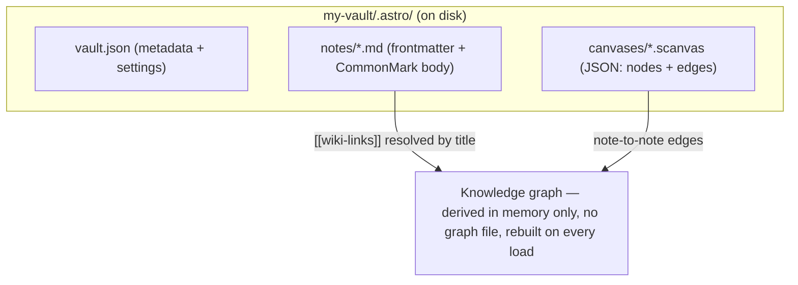

# Solen Vault Format — v1

A vault is a plain directory. Everything Astro creates lives under a hidden
`.astro/` subfolder — like `.git`/`.obsidian` — so the rest of the vault
folder stays clear for the user's own files (and, later, a graph-builder that
walks them). Everything under `.astro/` can be serialized to this layout and
read back losslessly. The format is human-readable, diff-able, and requires
no proprietary tooling.

```
my-vault/                 vaultDir the user picked
├── .astro/
│   ├── vault.json         Vault metadata and settings
│   ├── notes/             One Markdown file per note, filename mirrors title
│   │   ├── My Note.md
│   │   ├── research/       A folder — a real subdirectory, notes can nest arbitrarily
│   │   │   └── Idea.md
│   │   └── ...
│   └── canvases/          One JSON document per canvas
│       ├── <id>.scanvas
│       └── ...
└── ...                    the user's own files — not Astro notes
```



IDs are URL-safe random strings (nanoid-style, e.g. `n_x1y2z3`), stable for
the life of the object and the true identity of a note — **never** the
filename. A note's `id` lives in its frontmatter; its filename is a
human-facing mirror of its title that Astro keeps in sync (see "Filenames
mirror titles" below), so wiki-links, canvas edges, and the AI link index
(all keyed on `id`) never break on rename. See docs/ARCH-VAULT-STORAGE.md for
the full design rationale.

### Filenames mirror titles

- Renaming a note's title inside Astro renames its file to match.
- Renaming the `.md` file in the OS file explorer updates the note's title to
  match — a live filesystem watcher (`apps/desktop/src/vaultWatcher.ts`) picks
  it up within a few hundred milliseconds, no need to refocus the window (see
  docs/ARCH-VAULT-STORAGE.md problem 2). The filename wins over a stale
  frontmatter title, since renaming the file is the user's rename intent.
- Illegal filename characters (`/ \ : * ? " < > |`) are replaced with a space
  in the filename only; the frontmatter `title` keeps the original text.
- Two notes that sanitize to the same filename get a ` (2)`, ` (3)`, …
  suffix — never overwritten.
- A note with an empty or all-illegal title falls back to `<id>.md` until
  it's retitled.

### Folders

A note's folder is simply its parent directory under `.astro/notes/` —
there's no separate manifest; the directory tree *is* the folder model. A
folder is not a first-class graph node: it's a soft attribute
(`folder: "research"`) on the note, surfaced in the 3D graph as a grouping
signal rather than an edge-bearing node of its own.

### Migrating a pre-`.astro` vault

A vault created before this layout existed (top-level `vault.json`/`notes/`/
`canvases/`, opaque `<id>.md` filenames) is migrated automatically, once, the
first time it's opened by a build that supports `.astro/`: Astro moves its
own `vault.json`/`notes/`/`canvases/` into `.astro/` (atomic renames, not
copies — the data is only ever relocated, never duplicated or deleted), then
renames each opaque note filename to mirror its title. A `notes/` folder with
no matching legacy `vault.json` (i.e., one Astro didn't create) is never
touched.

## `vault.json`

```json
{
  "format": "solen-vault",
  "version": 1,
  "name": "My Vault",
  "createdAt": "2026-07-18T12:00:00.000Z",
  "settings": {
    "theme": "dark"
  }
}
```

`settings` is an open object; plugins may namespace their own keys
(`"my-plugin.someSetting"`). Unknown keys must be preserved on rewrite.

## Notes — `.astro/notes/<title>.md`

CommonMark with a YAML frontmatter block:

```markdown
---
id: n_x1y2z3
title: Distributed systems reading list
tags: [reading, systems]
createdAt: 2026-07-18T12:00:00.000Z
updatedAt: 2026-07-18T14:30:00.000Z
---

Notes link to each other with [[Wiki Links]] by title.
Tags can also appear inline as #hashtags.
```

- `title` is the canonical display name and the target of wiki-links.
- `[[Title]]` resolves case-insensitively against note titles; unresolved
  links are valid and render as "ghost" notes that can be created on click.
- `[[Title|alias]]` displays `alias` but links to `Title`.
- Everything below the frontmatter is the note body; no other syntax is
  reserved.

## Canvases — `.astro/canvases/<name>.scanvas`

Like notes, a canvas's filename mirrors its `name` (not its id) and is kept
in sync the same way on rename — same ` (2)`/` (3)` collision suffixing, same
`<id>.scanvas` fallback for an unnamed canvas. Canvases are flat (no
folders).

A `.scanvas` file is a UTF-8 JSON document:

```json
{
  "format": "scanvas",
  "version": 1,
  "id": "c_a1b2c3",
  "name": "Project Atlas",
  "createdAt": "2026-07-18T12:00:00.000Z",
  "updatedAt": "2026-07-18T14:30:00.000Z",
  "nodes": [
    { "id": "nd_1", "type": "note",  "x": 0,   "y": 0,   "width": 280, "height": 180, "noteId": "n_x1y2z3" },
    { "id": "nd_2", "type": "text",  "x": 400, "y": 60,  "width": 220, "height": 120, "text": "Inline scratch text" },
    { "id": "nd_3", "type": "link",  "x": 400, "y": 300, "width": 220, "height": 80,  "url": "https://example.com" },
    { "id": "nd_4", "type": "group", "x": -40, "y": -40, "width": 800, "height": 500, "label": "Research", "color": "violet" }
  ],
  "edges": [
    { "id": "e_1", "from": "nd_1", "to": "nd_2", "label": "supports", "color": "violet" }
  ]
}
```

### Node

| Field       | Type   | Required | Notes                                        |
|-------------|--------|----------|----------------------------------------------|
| `id`        | string | yes      | Unique within the canvas                     |
| `type`      | string | yes      | `note` \| `text` \| `link` \| `group`, or a plugin-registered type |
| `x`, `y`    | number | yes      | Top-left position in canvas coordinates      |
| `width`, `height` | number | yes | Size in canvas units                          |
| `color`     | string | no       | Named accent (`violet`, `blue`, `green`, `amber`, `red`) or `#rrggbb` |

Type-specific fields: `note` → `noteId`; `text` → `text`; `link` → `url`;
`group` → `label`. Plugin node types store their payload under `data`
(an open object). Readers must ignore unknown fields and preserve them on
rewrite.

### Edge

| Field   | Type   | Required | Notes                          |
|---------|--------|----------|--------------------------------|
| `id`    | string | yes      |                                |
| `from`  | string | yes      | Source node id                 |
| `to`    | string | yes      | Target node id                 |
| `label` | string | no       | Rendered on the edge           |
| `color` | string | no       | Same palette as nodes          |

## The knowledge graph is derived

There is no graph file. The graph is computed from two sources:

1. `[[wiki-links]]` in note bodies (note → note edges), and
2. edges between `note` nodes on canvases.

This keeps the format minimal and the graph impossible to corrupt: it can
always be rebuilt from the vault.

## Versioning and compatibility

- `version` is bumped only for breaking changes; readers must reject files
  with a greater major version than they support.
- Additive changes (new optional fields, new node types) do not bump the
  version. Readers ignore what they don't understand and writers preserve it.

## Export archive

A vault exported from the app is a ZIP of the *original* flat, id-keyed
layout (`notes/<id>.md`, `canvases/<id>.scanvas`, `vault.json` — no `.astro/`
subfolder, no title-mirrored filenames) — a deliberately storage-agnostic
portable format so it round-trips identically whether the vault being
exported (or imported into) is the filesystem adapter or the browser's
IndexedDB one, neither of which the archive format needs to know about.
Named `<vault-name>.astro-vault.zip`; importing restores the vault exactly.
