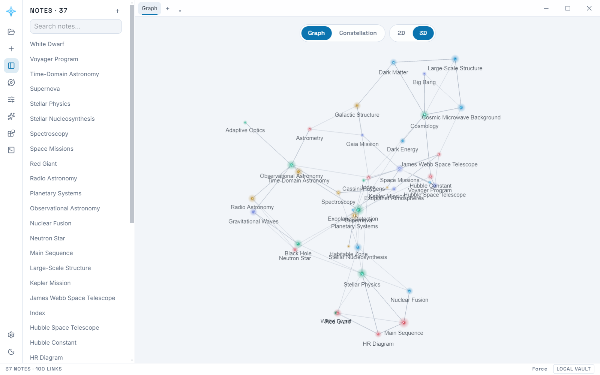

# Design language

The canvas is a **space, not a whiteboard**. Content reads as connected
*nodes* in depth, not as flat boxes on a page.

## Palette and type

The primary accent is an ice blue (`#4cc2ff` dark / `#0a74b0` light) —
legible against deep space, cool rather than corporate. The other four star
tints (blue, green, amber, red, plus a periwinkle-shifted fifth) exist only
as accent variety for nodes and never compete with the primary. Display
text — headers, the ribbon, the status bar, pill toggles, uppercase
micro-labels — sets in Space Grotesk; body copy and the editor set in Inter.
Both are self-hosted (no third-party font requests at runtime).

The same vault in the light theme — every surface, the ribbon, and the app's
own window buttons are theme tokens, so nothing stays dark against a light
page:

## Chrome

The window is a vertical icon **ribbon** (always visible: new note, sidebar/
constellation/AI/plugin/terminal toggles, settings, theme — vault export/
import lives in the sidebar footer and command palette instead) next
to a collapsible notes **sidebar**, with the 3D graph filling the full
remaining width and the editor/AI/plugin panels floating over it as their
own rounded, shadowed cards (`.floating-dock`) rather than docking
edge-to-edge and squeezing it narrower — the graph never resizes when a
panel opens. A slim **status bar** closes out the window with live
note/link counts and the current graph mode. This is the same "rail +
explorer + surface + floating panels + status strip" anatomy familiar from
other knowledge apps, adapted to a graph-first canvas instead of a document
tree.

## Node-first, depth-first ("constellation")

The single most important rule: **detail follows zoom**. A node's rendering
depends on the viewport scale, so the canvas feels dimensional — zooming out
compresses ideas into a constellation, zooming in unfolds them into content.

| Zoom level        | Node rendering                                             |
|-------------------|------------------------------------------------------------|
| Far (constellation) | Glowing accent dot + floating title label                |
| Mid (chip)        | Compact rounded chip: accent dot, title, link count        |
| Near / selected   | Full card: title + rendered Markdown preview               |

Transitions between levels are smooth (opacity/scale crossfade, ~150ms).
Nodes are **compact by default** — chips around 200×44px; full cards appear
only near or when a node is explicitly expanded (pin button on the chip).

## Atmosphere

- Near-black background with a subtle radial vignette; faint dot grid that
  fades with zoom-out so the constellation floats in dark space.
- Constellation Mode layers a soft space backdrop behind the graph — two
  nebula washes plus a scatter of faint star dots, crossfaded in over the
  base gradient. In the light theme the star dots fall away and it reads as
  a pale paper-sky instead.
- Nodes carry an accent-colored **glow** (soft box-shadow), stronger on
  hover/selection. Degree matters: more-connected nodes glow slightly larger
  in constellation mode.
- Edges are smooth béziers with a soft glow and a gradient from source to
  target accent; selected edges animate (slow dash drift).
- Motion is quiet: springy but short transitions, `prefers-reduced-motion`
  respected everywhere.

## Graph view

The knowledge graph is the same visual language at its extreme: a full-screen
force-directed constellation (d3-force) — glowing dots sized by connection
count, labels on hover/zoom, neighbor highlight on hover, click to open the
note. It must look alive: gentle simulation settle, no static hairball.

## Linking must not require syntax

`[[Wiki-links]]` remain the storage format and power users can always type
them. But every link must also be creatable **without typing any syntax**:

1. **`@` mention** — typing `@` in the editor opens the same note
   autocomplete as `[[`; picking a note inserts a proper wiki-link.
2. **Ctrl+L / Insert-link button** — fuzzy note picker over the editor;
   inserts a link to the chosen (or newly created) note at the cursor.
3. **Connections strip** — the editor footer lists outgoing links and
   backlinks as chips, with a **+ Connect** button that opens the picker and
   appends the link. Zero syntax, fully clickable.
4. **Canvas edges** — dragging an edge between two note nodes is itself a
   link and feeds the knowledge graph.

All four paths converge on the same stored representation, so the vault
format never grows a second link syntax.
