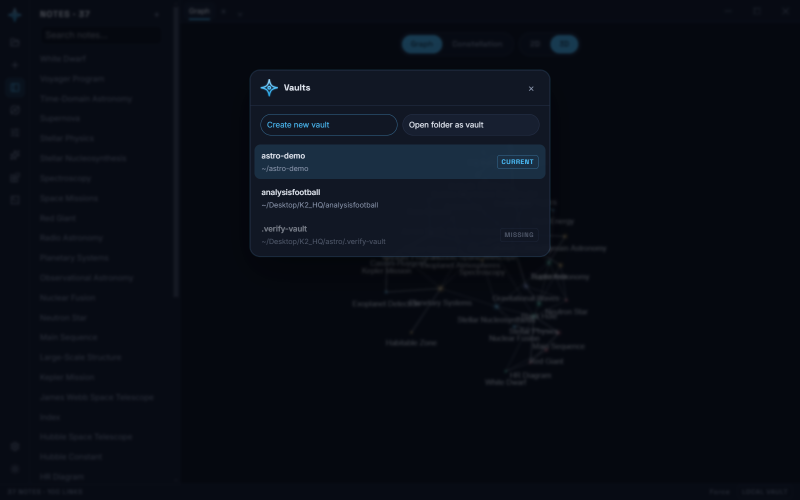
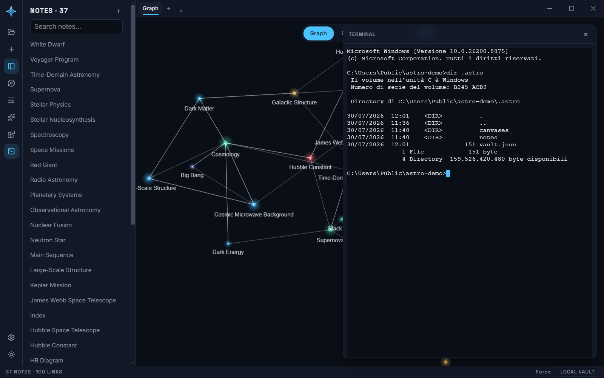

# Desktop app

`apps/desktop` is Astro packaged as a native app (Electron) around the same
`apps/web` build. The difference from the browser build is entirely in
storage: instead of IndexedDB, a vault is a real folder on your disk, and you
can have more than one.

## Vaults are plain folders

A vault folder holds exactly what [DATA-FORMAT.md](./DATA-FORMAT.md)
describes — `vault.json`, `notes/*.md`, `canvases/*.scanvas` — written
through `FilesystemVaultAdapter` (`apps/desktop/src/filesystemVault.ts`),
which implements the same `VaultAdapter` interface as the browser's
IndexedDB adapter (see [ARCHITECTURE.md](./ARCHITECTURE.md)). Every edit —
a note body, a dragged star, a settings change — auto-saves to that folder
on the same debounce the browser build uses; there's no separate "save"
action anywhere in the app.

Because it's just files, a desktop vault is trivially inspectable, backed up,
put under version control, or synced with any external tool — no export step
needed (the browser build's export/import ZIP flow still exists, but the
desktop app doesn't need it to get plain files).

## Switching vaults

The vault icon at the top of the ribbon opens the vault switcher: a list of
recently opened vault folders (most recent first), plus **Create new vault**
and **Open folder as vault**, each of which opens a native folder-pick
dialog. Clicking any vault — recent or freshly created/opened — switches the
app to it and reloads the window, so the app re-initializes cleanly against
the new vault's files. An empty folder (a fresh "Create new vault") seeds the
same demo content the browser build ships on first run; an existing vault
folder opens as-is.



A remembered vault whose folder is no longer on disk is listed as **Missing**
and cannot be opened. **Opening is never creating**: only "Create new vault"
(and the first-run folder picker) may bring a folder into existence. Clicking
a recent vault used to `mkdir` the path unconditionally, so a vault the user
had deleted came back as an empty folder — which, having no `vault.json`, the
renderer then seeded with the demo content, making a deleted vault look like a
restored one. Now the switch fails with a message and the dead entry is
dropped from the recents list. The same applies at startup: a remembered
current vault that has vanished is forgotten and the folder picker opens,
rather than the old path being silently recreated.

Missing is reported, not acted on, until you try to open it — "missing" also
describes an unplugged drive or an offline network share, and forgetting those
on a routine list refresh would lose the entry for good.

Paths are shown with the home directory collapsed to `~`, for the same reason
Settings → Connections does it: this is a pane people screenshot, and the raw
path publishes their account name.

The switcher (and the ribbon icon it's attached to) is desktop-only — it
never renders in the browser build, which always has exactly one vault.

## Running it

```bash
pnpm install
pnpm --filter @solen/web build      # apps/desktop loads apps/web's built dist/ (unless SOLEN_DEV_SERVER_URL is set)
pnpm --filter @solen/desktop dev    # compiles main/preload and launches Electron
```

`SOLEN_VAULT_DIR=/path/to/a/folder pnpm --filter @solen/desktop dev` skips
the startup folder-pick dialog entirely and opens that folder directly —
useful for scripting or repeated local testing.

## Window chrome

The window is created with `titleBarStyle: "hidden"` and **no**
`titleBarOverlay`: Astro draws its own minimize / maximize / close buttons in
the tab strip (`apps/web/src/components/WindowControls.tsx`), talking to main
over four `window:*` IPC channels. Native overlay chrome is painted on top of
the web contents, so it can't dim behind a modal backdrop and doesn't scale
with Settings → Interface zoom — it reads as a foreign rectangle in the corner.
DOM buttons theme, dim and scale with everything else for free. On macOS the
component renders nothing, leaving the system traffic lights in place.

## Integrated terminal

The ribbon's terminal button opens a shell in the current vault folder,
rendered with [xterm.js](https://xtermjs.org) in a floating panel
(`apps/web/src/components/TerminalPanel.tsx`). It is desktop-only: the button
is absent in the browser build, which has no shell to spawn.



The shell runs on a **real pseudoterminal** — `@lydell/node-pty`, a prebuilt
binary, so there is no native rebuild step and no `node-gyp` in the install
path. That matters because a piped `child_process` is not a TTY: interactive
CLIs (`claude`, `codex`, `gemini`, `vim`, `top`) detect the missing terminal
and either refuse to draw or render nothing at all, and Ctrl+C cannot signal
the running process, only edit the local line buffer. With a PTY the panel
behaves like the system terminal: the shell echoes, raw mode works, Ctrl+C
interrupts, and resizing the panel sends a real resize down to the shell.

The renderer never chooses the command or the working directory — main
decides both (`apps/desktop/src/terminal.ts`, `apps/desktop/src/main.ts`),
so a compromised renderer cannot turn the terminal bridge into arbitrary
process execution.

## Building a packaged app

```bash
pnpm --filter @solen/desktop dist
```

This builds `apps/web`, compiles `apps/desktop`'s main/preload, and runs
[electron-builder](https://www.electron.build) (config lives in
`apps/desktop/package.json`'s `"build"` field) to produce a native installer
under `apps/desktop/release/` — a `.dmg` on macOS, an NSIS installer on
Windows, an AppImage on Linux. `pnpm --filter @solen/desktop pack` builds an
unpacked app directory only, without the installer step, which is faster for
a quick local check.

electron-builder downloads platform build tools and, for the target you're
building, a prebuilt Electron binary — both need real network access, so
this step has to run on your own machine rather than in a sandboxed CI
environment with restricted egress.

## Testing away from your own machine

Two checks exist to prove Astro works on a machine that isn't yours, and that
it never leaks your own filesystem paths or username into the repo or into
what the MCP server hands back to a client.

`node scripts/check-no-personal-paths.mjs` (or `pnpm check:paths`) scans
every git-tracked file for Windows/POSIX home-directory paths, plus the
current machine's own username and home directory (read at runtime, so the
check works for any contributor). `packages/mcp-server/src/__tests__/sandbox.test.ts`
builds a synthetic vault under a fabricated `userData` root inside a temp
directory, spawns the built MCP server (`pnpm --filter @solen/mcp-server
build` first) against it over real stdio JSON-RPC, and asserts the tool
output contains exactly the seeded notes and never contains this machine's
real home directory or username.
