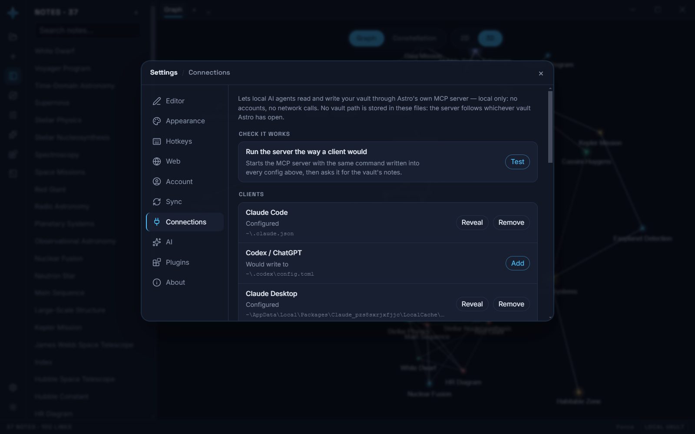
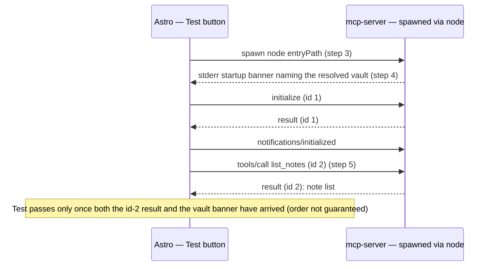

# MCP server

`packages/mcp-server` exposes a Astro vault to external AI agents over
the [Model Context Protocol](https://modelcontextprotocol.io) (MCP) — an
open standard for connecting AI agents to tools and data. Any MCP-capable
agent (a chat client, an IDE assistant, an autonomous agent framework) can
point at the server and read, search, or write notes and read the knowledge
graph, using the vault as its context instead of being told to paste notes
in by hand.

This is the "open API" half of Astro's local-first design (see
[ARCHITECTURE.md](./ARCHITECTURE.md)): the vault format is already open
files on disk; the MCP server is a small, optional bridge that lets agents
use that openness without needing to know Astro's internals.

## How it works

The server is a Node CLI (`solen-mcp`) that speaks MCP over stdio, and reads
fresh from disk on every tool call: no daemon, no cache, no database.

By default it needs no arguments at all: it reads the vault the desktop app
currently has open, from the app's own `desktop-config.json`, on every call.
Switching vaults in Astro therefore switches what an already-running agent
sees — no config edit, no restart.

`--vault <directory>` overrides that, for a vault the app doesn't have open
(or a machine where the app isn't installed). It points at a vault **root**
in the layout described in [DATA-FORMAT.md](./DATA-FORMAT.md)
(`.astro/vault.json`, `.astro/notes/*.md`, `.astro/canvases/*.scanvas`) — the
root folder, not its `.astro` subfolder; the server appends `.astro` itself.

## Connecting the desktop app to an agent

The desktop app's vault folder already **is** that directory — there's no
export step. The easiest way to wire an agent up is Settings → **Connections**:
one row per client (Claude Code, Codex / ChatGPT, Claude Desktop, Cursor,
Antigravity, Goose), and **Add** merges an `mcpServers`/`mcp_servers`/`extensions`
entry named `astro` into that client's own config file, pointing at
`packages/mcp-server`'s built entry — leaving every other entry in that file
untouched, and backing up the original first (`<file>.astro-backup`). **Remove**
takes just that one entry back out.



**No vault path is written into any client config.** The entry names the
server and nothing else; the server resolves the open vault itself. Writing
the path would freeze whichever vault happened to be open when the button was
pressed, and silently strand the agent on it after the next vault switch.

Each row states the exact file it writes and whether that entry is currently
in it — **Configured** / **Not configured**. That is all Astro can observe: it
writes a config file, it never watches the agent run, so no row claims the
client is "connected". Paths are shown with the home directory collapsed to
`~`, both so the long ones fit on one line and so a screenshot of the pane
doesn't publish an account name. A row also carries a **not detected** tag, and
that tag is the result of an actual search, not a guess: Astro probes the
client's real install locations (executables and per-user data folders — never
the config folder, which outlives an uninstall), then every `DisplayName` in
Windows' uninstall registry (`HKCU` and `HKLM`, including the 32-bit view), then
Start Menu shortcut names under both the user and all-users trees. Any one hit
counts as detected. It is still a hint, not a gate — no probe covers every
install method, and a portable or Store build can register none of the three —
so every row stays actionable either way; adding an entry for a client Astro
can't find just asks for confirmation first. See `apps/desktop/src/clientDetect.ts`.

A row reads **stale entry** when it is configured but with something other than
what Astro writes today — a leftover `--vault` argument from an older version,
or an entry point that has since moved. That is the most common silent failure,
because nothing errors: the client happily launches a command that no longer
works. **Update** rewrites it.

### Proving it actually works

The chain from Astro to an agent reading your vault has five links, and Astro
can only see some of them:

| Step | Observable by Astro |
|---|---|
| 1. Astro writes the `astro` entry into the client's config | yes — it wrote it, and re-reads it |
| 2. The client reads that file when it starts | **no** |
| 3. The client runs `node <entry>` | no, but reproducible |
| 4. The server resolves the open vault | no, but reproducible |
| 5. The server answers a tool call | no, but reproducible |



So **Test** in that tab runs steps 3–5 itself: it spawns the server with the
exact command those config files contain, performs a real MCP handshake, and
reports the vault the server resolved on its own plus how many notes it could
see. A green result means everything downstream of the config file works.

It says nothing about step 2, and cannot — that is the client's business. A
client that was already running when you pressed Add has to be restarted before
it reads the new entry.

Codex and the ChatGPT desktop app share one config (`~/.codex/config.toml`),
so a single row covers both. Antigravity's location and schema come from its
own shipped documentation (`~/.gemini/config/mcp_config.json`).

Claude Desktop gets several candidate locations rather than one, and the first
that exists wins. Its Microsoft Store (MSIX) build reads a redirected config
under its own package container
(`%LOCALAPPDATA%\Packages\Claude_pzs8sxrjxfjjc\LocalCache\Roaming\Claude\`),
not the `%APPDATA%\Claude\` the plain Windows installer uses — write the wrong
one and the app sees no MCP server at all. That build also registers no
uninstall key and no Start Menu shortcut, so detection looks for the package
container too.

### Goose

[Goose](https://goose-docs.ai/) (Block's on-machine AI agent) keeps its config
at:

- Windows: `%APPDATA%\Block\goose\config\config.yaml`
- macOS/Linux: `~/.config/goose/config.yaml`

Unlike the other verified clients, this file is YAML, so Astro splices the
`astro` entry in by line/indentation rather than by parsing the whole
document — it only ever touches the lines of its own `astro:` block under
`extensions:`, detecting the file's own indentation instead of assuming 2
spaces. The block Astro writes:

```yaml
extensions:
  astro:
    name: astro
    cmd: node
    args:
      - "/path/to/packages/mcp-server/dist/index.js"
    enabled: true
    type: stdio
    timeout: 300
```

Detection looks for `%APPDATA%\Block\goose\data` (Windows) or
`~/.local/share/goose` (macOS/Linux) — not the config folder, which (like the
other clients) can outlive an uninstall.

Cline and Pi keep their config somewhere that varies by install, so the app
does not write those for you — their rows show the JSON snippet and a Copy
button to paste in by hand. That split is deliberate: writing a config whose
schema we haven't confirmed can break the user's own tooling.

To wire up a client by hand instead (see [the package
README](../packages/mcp-server/README.md) for build instructions and an
example client configuration):

```bash
solen-mcp                                # follows the vault Astro has open
solen-mcp --vault "/path/to/your/vault"  # or pin one explicitly
```

If you're on a build without the desktop app (or the vault lives outside
it), export still works the same way it always has: **Export vault** from
the sidebar footer or command palette downloads `<vault-name>.astro-vault.zip`
— unzip it to a directory and point the server at that instead. Because
export/import round-trips losslessly, you can re-export after editing in the
app and re-point the server at the fresh copy, or use `write_note` from an
agent and **Import vault** to bring changes back in.

## Tool reference

| Tool            | Input                   | Output                                                          |
|-----------------|--------------------------|-------------------------------------------------------------------|
| `list_notes`    | —                        | Every note's id, title, tags, updatedAt (no body)                 |
| `read_note`     | `{ id? , title? }`       | Full note: frontmatter + Markdown body                            |
| `search_notes`  | `{ query }`              | Case-insensitive substring matches over title + body, with a ±1-line snippet |
| `write_note`    | `{ title, body, id? }`   | Creates a note, or overwrites one by id; updates `updatedAt`      |
| `list_canvases` | —                        | Every canvas's id, name, updatedAt                                 |
| `read_canvas`   | `{ id? , name? }`        | Full `.scanvas` JSON document (nodes + edges)                     |
| `get_graph`     | —                        | The derived knowledge graph: `{ nodes, edges }`                   |
| `get_vault_file_graph` | —                 | Every file/folder in the vault as a graph: nodes + containment/mentions edges |

Every note is additionally exposed as an MCP resource at
`solen://notes/<id>`.

## Security note

The server only has file access to one vault directory — the one Astro has
open, or the one passed as `--vault`. It makes no network calls and touches
nothing else on disk. It can read every note and canvas in that directory and
can create or overwrite note files under `notes/`. Anyone able to talk to the
server process (over stdio, or via whatever transport your MCP client uses to
launch it) has that level of access.

Note the consequence of following the open vault: which vault a connected
agent can reach is whichever one you last opened in Astro. If you keep a vault
you would not hand to an agent, either disconnect the client before opening
it, or pin the agent to a specific directory with `--vault`.
