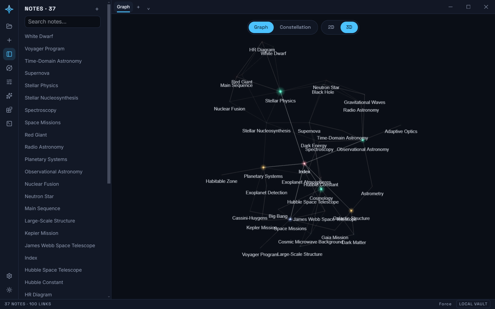
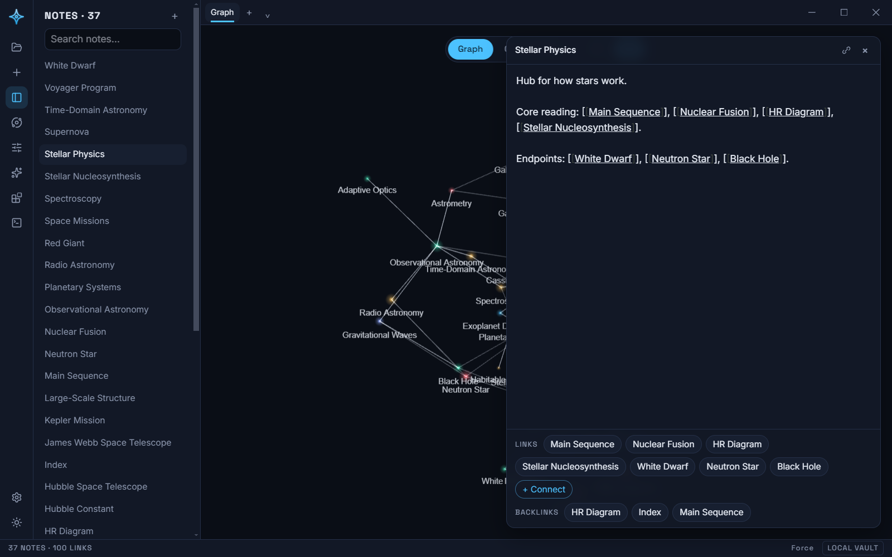
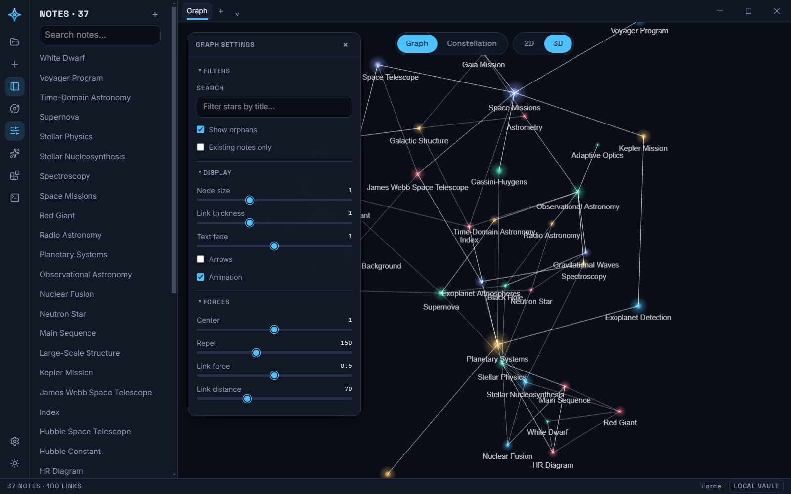

# The 3D workspace

The graph is not a side view — **it is the workspace**. Astro opens directly
into the 3D graph (force layout), with Constellation Mode one toggle away.
Where classic tools ship a read-only graph next to a 2D editing surface,
Astro's sky is directly editable: you think *in* the graph.

The 2D canvas surface is removed from the app. The `.scanvas` format stays
part of the vault (core, export, MCP) and canvas edges still feed the
derived graph, but the app's one surface is the sky.

## Floating panels

The Editor, AI panel, terminal, and plugin drawer don't dock edge-to-edge and
squeeze the graph narrower the way they once did — they float over it as their
own rounded, shadowed, blurred cards (`.floating-panel`, anchored inside
`App.tsx`'s `.floating-dock`), the same visual language the Graph settings
panel already used. The graph itself always renders at full width behind
them; opening a note or the AI panel never resizes it, only overlays it. Up
to four can be open at once — the editor, the AI panel, the terminal
(desktop-only, see [DESKTOP.md](./DESKTOP.md)), and a plugin panel — laid out
left-to-right in that same dock, each sized independently (the editor widest,
capped so it never crowds out the graph entirely on a narrow window). Graph
settings stays anchored top-left specifically so it never collides with this
dock's top-right corner when both are open.

## In-app browser

External `http(s)` links clicked inside rendered markdown (the AI panel today,
any note-body preview later) don't kick out to the OS browser — they open as a
sibling tab in the workspace tab strip at the top of the window, next to the
permanent graph tab (see [ARCH-TAB-WORKSPACE.md](./ARCH-TAB-WORKSPACE.md)),
the way Claude Desktop and Obsidian embed a browser. Back / forward / reload /
stop, an editable address bar, and an explicit "open in system browser" action
(the only path to the OS browser — a `target="_blank"`/`window.open` click
opens a new tab in the strip instead, never a bare OS window) live in a slim
toolbar (`WebToolbar.tsx`) shown only while a web tab is active; closing is the
tab's own × in the strip (or Ctrl+W).

A single delegated click listener in `App.tsx` catches any `a[href^="http"]`
inside a `.markdown-body`, calls `preventDefault` (so the click never navigates
the whole app window away — Electron's default for a bare `<a>`), and routes it
to `store.openBrowser(url)`. Under Electron, tabs are real `WebContentsView`s
(Electron's current recommended embed API, replacing both the deprecated
`BrowserView` and the older `<webview>` tag) managed in the main process by
`BrowserTabManager` (`apps/desktop/src/browserTabs.ts`) and layered onto the
main window's own `contentView`. Since a `WebContentsView` is a native layer
with no notion of DOM layout, `WebViewport.tsx` continuously reports its
`.workspace-viewport` div's `getBoundingClientRect()` over IPC (`browserAPI.
setBounds`) so the active tab is drawn in exactly the right place — the one
piece of manual bounds-syncing this trades for `<webview>`'s automatic DOM
sizing. Each tab's `webPreferences` locks down `contextIsolation`/`sandbox`/no
`nodeIntegration` independently of the main window's own. The plain-browser dev
build (no `window.vaultAPI`/`browserAPI`) has no embedded browser to host a
page, so the interceptor falls back to a normal `window.open` new tab there.
`main.ts` also denies any stray top-level navigation / window-open on its own
frame as defence-in-depth.

## Motion

The whole UI chrome moves as one system, CSS-only (no animation library). Two
shared tokens in `index.css` — `--ease-out` (an Apple-style ease-out curve) and
`--dur-panel` — drive every floating panel and overlay's entrance and exit:
cards scale/slide/fade in and back out, scrims cross-fade. Panels that render
`null` when closed can't animate out on their own, so `usePanelMount` keeps the
node mounted for one `--dur-panel` window and toggles a `.panel-open` /
`.panel-closed` class the transition eases between. Buttons, toggles, chips, and
the ribbon/graph pills get subtle hover + pressed (`transform: scale`)
feedback. All of it collapses to instant under
`@media (prefers-reduced-motion: reduce)` (an Apple HIG requirement). The 3D
scene's own WebGL transitions are a separate system (see below) and untouched.

## Direct manipulation

Everything below works in both Force and Constellation modes, with zero
syntax required:

| Gesture | Effect |
|---|---|
| Click a star | Open the note in the editor |
| Drag a star | Move it; on release it rejoins the simulation (no freeze) |
| **Shift-drag star → star** | Link the two notes — you just draw the line. The link is a **structural edge**, stored the way canvas edges already are in the vault. **No brackets, no syntax, nothing written into any note's text.** |
| **Shift-drag star → empty space** | Create a new note there, already linked from the source — the fastest capture flow |
| Double-click empty space | New note at that point; editor opens with the title focused |
| Select + `Delete` | Delete the note (confirm first) |
| Click an edge | Small popover → **Unlink** (removes the structural edge) |
| Hover | Star: highlight neighborhood. Edge: brighten |
| `Ctrl+G` | Toggle Force ↔ Constellation |

**Links are relations, not text.** Drawing a line between two stars creates a
structural edge in the vault (the same `edges` a canvas already stores) — the
graph *is* the source of truth for these connections. No `[[bracket]]` is
ever written into a note by a gesture. Wiki-links still work for anyone who
*wants* to type `[[Title]]` inside a note (they resolve and show up in the
graph too), but they are never forced and never the default — the fast,
easy path is simply to draw the line.

## Repositioning stars

Dragging fixes a star's position (`fx/fy/fz`) each frame so it tracks the
cursor exactly. On release the fixed position clears and the simulation
reheats, so the star settles back in on its own: nothing stays frozen where
you drop it. The `settings.graph` vault-settings key that once held dropped
pins (`{ pins: { [noteId]: [x, y, z] } }`) is, as of the Graph settings
panel (see "Graph settings panel" below), repurposed to hold that panel's
Filters/Display/Forces state instead — an older vault's saved pins are
simply overwritten the first time anything in the panel is touched, the same
as they already went unread before the panel existed.

## Graph settings panel

A floating panel, opened from the ribbon's sliders icon or the Command
Palette's "Graph settings" action, anchored top-left over the graph — the
top-right corner is the floating dock's territory (see "Floating panels"
below). Three collapsible sections:

- **Filters** — a text search that dims (not hides) stars whose title
  doesn't match, plus "Show orphans" (degree-0 stars) and "Existing notes
  only" (hides ghost/unresolved wiki-link target stars, like a `[[Someday
  Maybe]]` no note has been written for yet) toggles.
- **Display** — Node size, Link thickness, and Text fade sliders, an Arrows
  toggle (directional arrowheads on every edge, wiki-link or canvas/drag-
  created — both carry a real from/to at creation time, sized to stay
  legible at typical camera distances), and an Animation toggle that's the
  same flag the status bar's own animation control uses (enabling it while
  flat in 2D also switches to 3D, since auto-rotate/sway only exist there).
  Text fade (0-2, default 1) is opacity, not just a label-count cap: at or
  below 1 it also scales each label's drawn alpha (0 fades every label out
  completely), above 1 it's a no-op on top of the count budget.
- **Forces** — Center, Repel, Link force, and Link distance sliders driving
  the live d3-force-3d simulation. Center is positional gravity pulling every
  node toward the origin, not `forceCenter`'s mean-recentering — raising it
  pulls disconnected clusters ("archipelagos") together, lowering it lets
  them drift apart.

All of it persists to `settings.graph` (debounced, so a slider drag doesn't
hit IndexedDB on every tick); the panel's own open/closed state does not.

## What the physics does while you work

- Dragging sets the fixed position each frame and reheats the simulation at
  low alpha so neighbors follow naturally; releasing clears the fixed
  position and reheats again so the star itself rejoins the simulation.
- Creating a note spawns its star at the spawn point with a gentle pop-in.
  Any topology change that isn't the vault's first load (a note created,
  deleted, or linked) temporarily fixes every already-settled star in place
  and only lets the genuinely new node(s) move — the rest of the layout
  doesn't reshuffle just because one unrelated note appeared — then releases
  them for a few closing ticks of local give as the settle finishes.
- Constellation Mode remains a static layout: edits still work (click, link,
  create), and the asterism regenerates with a short transition when
  topology changes.

## Opening the sky

The first time a vault's graph loads in a session, it doesn't just appear —
it's born. Every star starts bunched into a small jittered cluster near the
origin, invisible and tiny, then bursts outward to its real layout (the same
force-scattered or constellation-target position it would otherwise have
opened at) over about 1.3 seconds, brightening and growing to full size in
lockstep. Edges fade in over the same window. It's the same cubic-ease
`LayoutTransition` the Force ↔ Constellation toggle already uses for its own
animated switch, just slower and paired with a matching brightness ramp
(`SceneRenderer.startEntrance`) on the stars and edges themselves — so the
first sight of a vault reads as a distinct, special moment rather than a
graph popping into view fully formed. It plays once, on that initial load;
switching modes or refreshing the topology afterward uses the normal
(un-ramped) transition. Never during the reveal does the physics simulation
tick — once it finishes, Force mode's simulation picks up exactly where the
burst left off, since it was constructed against that same target position
from the start.

## 2D / 3D

A pill next to the Graph/Constellation toggle switches between the full 3D
orbit-camera graph and a flat 2D one — the persisted `graphDimension` vault
setting (`settings.ui.graphDimension`, default `"3d"`), also reachable from
the Command Palette ("Switch to 2D / 3D") and preserved by Ctrl+G. In 2D the
force simulation gets a strong `forceZ(0)` positioning force so nodes settle
onto the z=0 plane instead of drifting in depth. The camera starts face-on
(`position (0, 0, dist)`, looking at the origin) and rotation is off entirely
(not just constrained) — orbiting a flat plane from an angle still reveals
it's a 3D scene via perspective foreshortening, which reads as "still feels
like 3D." Dragging empty space instead pans: OrbitControls' left mouse button
(and one-finger touch) remaps from its 3D default of orbit-rotate to pan in
2D, since rotate is disabled there and would otherwise leave a left-drag
doing nothing — the orbit pivot's z is pinned to 0 every frame (`controls.
target.z = 0`) so panning slides along the plane instead of drifting off it
along the plane's normal. Zoom works as always. In 3D, left-drag still orbits
(the primary way to move the camera there) — pan is reachable via the right
mouse button/middle-drag, same as any standard 3D viewport. Switching
dimension eases the camera to/from the face-on position over
about three quarters of a second rather than snapping. Constellation Mode's
dome is a static layout (not sim-driven), so 2D there just needs the same
camera lock — see [CONSTELLATION.md](./CONSTELLATION.md).

3D also auto-rotates: a slow (~80s/orbit) `OrbitControls.autoRotate` runs
whenever the graph is idle, pausing the instant you touch the camera (or drag
a star) and resuming about 2.5s after you let go. This is gated by
`graphAnimating` (`settings.ui.graphAnimating`, default on), toggleable from
the Command Palette ("Toggle graph animation") — Phase 18's animation control
will bind to the same flag. The same idle window also eases `controls.target`
back toward the graph's centroid, so a stray pan (which displaces the orbit
pivot) doesn't leave auto-rotate circling some unrelated star once it resumes.

## Rendering additions

Same budget as [CONSTELLATION.md](./CONSTELLATION.md) (pooled buffers, one
draw call per primitive class, no post-processing). New affordances stay
cheap: the link-drag preview is a single line segment + target glow; the
edge popover and note-title prompt are DOM, not GPU.

## Out of scope (for now)

Local-graph depth filtering, tag-colored groups, and search filters over the
sky — planned as the graph's equivalent of a query bar, once direct
manipulation covers more ground first.
